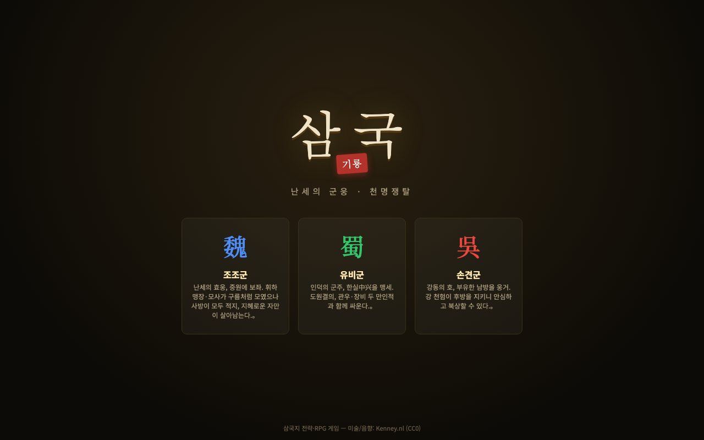
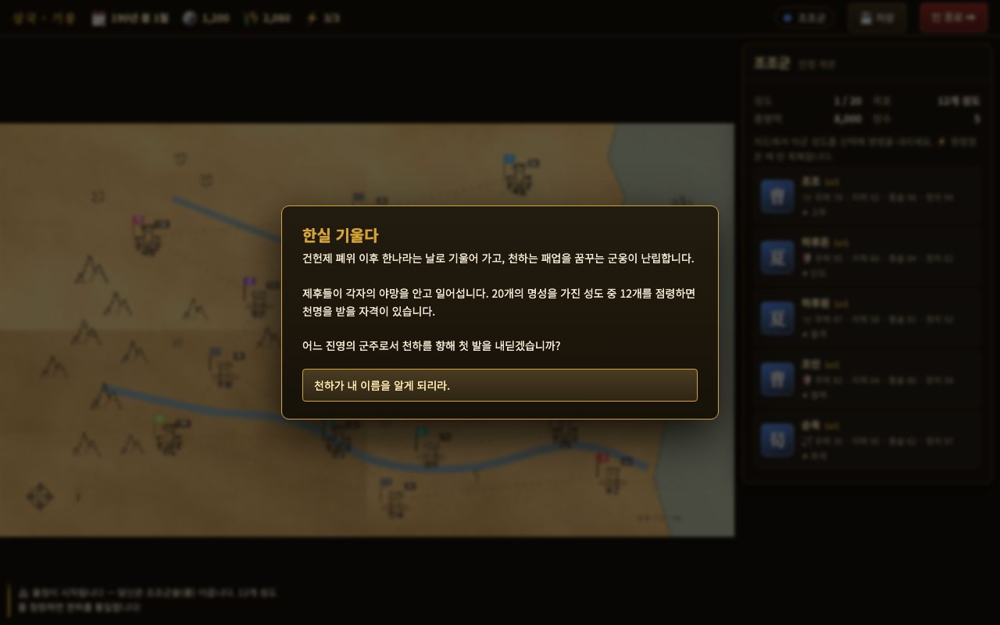
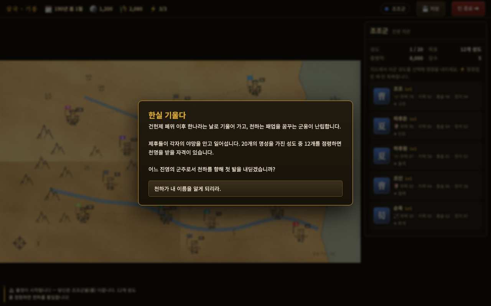

# 삼국・기용 — 한국어 한글화 포크

> **三国・起龍 (Romance of the Three Kingdoms)**
> [ryantsai/sango-rising-dragons](https://github.com/ryantsai/sango-rising-dragons)의 한국어 한글화 포크

[](https://sigco3111.github.io/sango-rising-dragons-kr)
[](https://github.com/sigco3111/sango-rising-dragons-kr)
[](https://github.com/sigco3111/sango-rising-dragons-kr)
[](https://sigco3111.github.io/sango-rising-dragons-kr)
[](#-라이선스)

西元 190년, 한실 기울다. 군웅이 일어나 천하를 다투는 난세 —
**한글화된 인터페이스**로 클래식 3국지 전략/턴제 전투 게임을 즐기세요.

## ✨ v0.5 업데이트 (자동위임 + 밸런스 + 안정화)

| 항목 | 내용 |
|---|---|
| 🤖 **풀 자동위임** | 상단 토글 ON → 매 턴 모든 행동을 AI가 위임 |
| 🎯 **위임 AI C안** | 출정 점수화 (전력비 + 적 약점 보너스 + 체인 보너스), 부대 합치기 |
| ⚖️ **밸런스 C안** | 시작 자원 여유 + 수도 성벽+1 + 재야 장수 무료 영입, 적 공성 약화 |
| ⌨️ **Enter 단축키** | 턴 종료 단축키 (모달/입력 필드 자동 무시) |
| 🛡 **NaN 안전망** | troopsHome amount/v 양쪽 지원 + 세이브 자동 정화 |

## ✨ v0.3 한글화 현황

| 항목 | 상태 | 진행률 | 비고 |
|---|---|---|---|
| 도시 이름 (20개) | ✅ 완료 | 100% | ko/cities.json |
| 도시 설명 (20개) | ✅ 완료 | 100% | 역사/지리 설명 추가 |
| 장수 이름 (49명) | ✅ 완료 | 100% | ko/officers.json |
| 장수 별칭 (49명) | ✅ 완료 | 100% | 패왕/맹장/참모 등 |
| 장수 풀네임 (49명) | ✅ 완료 | 100% | "조조 (패왕)" 형식 |
| 진영/군주 (11개) | ✅ 완료 | 100% | 위/촉/오/동탁 등 |
| 진영 한자 심볼 → 한국어 | ✅ 완료 | 100% | 위/촉/오 등 1글자 (v0.4 fix) |
| 진영 시그니처 | ✅ 완료 | 100% | 천하를 다스릴 자 등 |
| 진영 시작 위치 | ✅ 완료 | 100% | 진류/성도/오군 |
| 진영 설명 | ✅ 완료 | 100% | ko/factions.json desc |
| 아이템 (5개) | ✅ 완료 | 100% | 옥새/적토마/청룡언월도 등 |
| 스킬 (7개) | ✅ 완료 | 100% | 돌격/화계/일기당천 등 |
| 이벤트 (12개) | ✅ 완료 | 100% | ko/events.json |
| 이벤트 choices (풍성) | ✅ 완료 | 100% | 효과 설명 포함 |
| 인트로 모달 (3단락) | ✅ 완료 | 100% | 한실 기울다 |
| UI 텍스트 (HTML + TS) | ✅ 완료 | 100% | 한자 0개 |
| 액션 버튼 hover 도움말 | ✅ 완료 | 100% | 효과 설명 풍성 |
| 출정 모달 (별칭/남겨둘 병력) | ✅ 완료 | 100% | 보강됨 |
| Noto Sans KR 폰트 | ✅ 완료 | 100% | Google Fonts CDN |
| 사이드패널 병력 NaN 가드 | ✅ 완료 | 100% | fmtNum() fallback (v0.4) |
| troopsHome amount/v 호환 | ✅ 완료 | 100% | 황건 토벌 / 자연 치유 NaN fix (v0.5) |
| 세이브 자동 정화 | ✅ 완료 | 100% | 로드 시 NaN troops → 1,000 복구 (v0.5) |

> **원작자 라이선스 확인 필요** — 원본 저장소에 LICENSE 파일이 명시되지 않았습니다.
> 포크는 학습/연구 목적 권장. 상업적 사용은 원작자(`@ryantsai`)에게 허락 받으세요.

## 🎮 게임 특징

- **전략 레이어**: 매 턴 한 달, 명령 포인트(3 + 도시수/2)로 도시 경영
  - 🌾 개간 / 🪙 통상 / 🧱 축성 / ⚔ 징병 / 🔍 수색 / 🎯 조련 / 🚩 출정
- **전술 전투**: 턴제 보드 전투, 6종 유닛 상성, 7종 장수 스킬
  - 돌격 / 일기당천 / 화계 / 화우 / 고무 / 철벽 / 신사
- **풍부한 콘텐츠**: 49명 장수, 20개 도시, 11개 진영, 12개 역사 이벤트
- **자동 저장/계속**: 매 턴 localStorage 자동 저장
- **🤖 풀 자동위임 (Autopilot)**: 상단 토글 ON → 매 턴 모든 행동을 AI가 위임
  - 우선순위: 적지 출정 → 부대 재배치 → 재야 수색 → 장수 조련 → 개발/징병
  - 출정 점수화: 전력 비율 + **적 약점 보너스**(벽 낮음/병력 적음) + **체인 보너스**(공격 후 인접 적 추가 가능)
  - 부대 합치기: 약한 도시(troops<5000)에서 강한 인접 아군 도시로 자동 이동
  - 출정 강도: CP 충분할 땐 공격적(ratio>1.0), 부족할 땐 보수적(ratio>1.4, AI와 동일)
  - 방어전 자동 결산, 출정 모달 생략 → **턴 종료만 누르면 엔딩까지 자동 진행**
  - 토글 상태는 localStorage에 영속 저장 (새로고침 후에도 유지)
- **⌨️ 키보드 단축키**: Enter = 턴 종료 (모달/입력 필드 자동 무시)
- **🛡 NaN 안전망**: troopsHome은 `amount`/`v` 양쪽 호환, 세이브 로드 시 자동 정화 (`__sangoSaveHeal` 콘솔 훅)
- **모드 친화적**: `public/data/ko/`에 JSON만 추가하면 신규 콘텐츠 반영

## ⚖️ 밸런스 (C안)

| 항목 | 값 |
|---|---|
| 시작 자원 | 금 1,500 / 식량 3,500 |
| 개발 비용 | 300 금 |
| 징병 비용 / 보너스 | 150 금 + 200 식량 / +2,000 병력 |
| 시작 보너스 | 수도 성벽 +1 (최대 5), 재야 장수 1명 무료 영입 |
| 적 AI 공성 threshold | ratio > 1.7 (이전 1.45) |
| 적 AI 공성 빈도 | 40% (이전 65%) |

## 🚀 빠른 시작

### 방법 1: GitHub Pages (현재 Production, 권장)

이 저장소는 GitHub Pages에 호스팅되어 있어요 (Vercel 사용 이력 — 2026-08 GitHub Pages로 전환).

```bash
# 정적 빌드 후 gh-pages 브랜치에 배포
npm install
./play.sh build
npx gh-pages -d dist -b gh-pages
# → https://sigco3111.github.io/sango-rising-dragons-kr
```

### 방법 2: Vercel 배포 (Vercel 사용 이력 — CLI 보존, 1분)

[](https://vercel.com/new/clone?repository-url=https://github.com/sigco3111/sango-rising-dragons-kr)

1. 위 버튼 클릭
2. GitHub 로그인
3. 자동 빌드 + 배포 (1~2분)
4. `*.vercel.app` URL에서 게임 플레이

### 방법 3: 로컬에서 빌드 + 실행

```bash
# 의존성 설치
npm install

# 정적 빌드
./play.sh build

# 정적 서버 시작
./play.sh serve
# → 브라우저에서 http://localhost:8080 열기
```

### 방법 4: Vite 개발 서버 (HMR)

```bash
npm install
./play.sh dev
# → http://localhost:5173
```

### 방법 5: 브라우저에서 직접 열기

```bash
./play.sh build
./play.sh open
```

`file://` 프로토콜에서 fetch()가 제한될 수 있어 **방법 1~3 추천**.

## 🛠 빌드 요구사항

- **Node.js** 22+ (테스트됨)
- **npm** 10+ (테스트됨)

빌드 시간: **~2.2초** (17 modules, M4 Mac 기준)
| Vercel 배포 시간 (Vercel 사용 이력) | **1~2분** (cold start 기준) |

## 🗂 프로젝트 구조

```
sango-rising-dragons/
├── index.html              # 메인 HTML (lang="ko")
├── package.json
├── tsconfig.json
├── vite.config.ts          # Vite 설정 (base: '/sango-rising-dragons-kr/' for Pages, '' for Vercel)
├── vercel.json             # Vercel 배포 설정 (사용 이력 보존)
├── .vercelignore           # Vercel 배포 제외 파일
├── public/
│   ├── assets/             # Kenney CC0 아트/음향
│   ├── data/
│   │   ├── manifest.json   # {"packs": ["base", "ko"]}
│   │   ├── base/           # 원본 중국어 데이터
│   │   │   ├── cities.json     (20개)
│   │   │   ├── officers.json   (49명)
│   │   │   ├── factions.json   (11개)
│   │   │   ├── events.json     (12개)
│   │   │   ├── items.json      (5개)
│   │   │   └── skills.json     (7개)
│   │   └── ko/             # 한국어 모드팩 (덮어쓰기)
│   │       ├── cities.json  (desc 추가)
│   │       ├── officers.json (alias, full_name 추가)
│   │       ├── factions.json (symbol, slogan, start_city 추가)
│   │       ├── events.json  (v: amount 호환)
│   │       ├── items.json
│   │       └── skills.json
├── src/
│   ├── main.ts            # 진입점
│   ├── content.ts         # 데이터 로더 (base → ko 머지)
│   ├── hud.ts             # UI (한국어 적용 완료, 풍성화, 자동위임 토글, Enter 단축키)
│   ├── state.ts           # 게임 상태 + 자동위임 결정 큐 + NaN 안전망
│   ├── flow.ts            # 게임 흐름 (endTurn / 방어전 자동 결산)
│   ├── types.ts
│   ├── scenes/
│   │   ├── BootScene.ts
│   │   ├── MapScene.ts    # 전략 맵 (한국어 깃발 symbol)
│   │   └── BattleScene.ts # 전술 전투
│   ├── battle/
│   │   └── model.ts       # armyPower, autoResolve, applyBattleResult
│   ├── ai.ts              # AI 진영 행동 (C안: threshold 1.7, 빈도 40%)
│   └── ...
├── screenshots/           # 게임 스크린샷 (v0.x 시리즈)
├── docs/                   # 추가 문서
├── play.sh                 # 실행 스크립트 (dev/serve/build/open)
└── README.md
```

## 🌍 한국어 모드팩 구조

`public/data/ko/` 폴더는 원본 데이터를 덮어쓰는 한국어 모드팩입니다.
`manifest.json`의 `packs` 배열에 따라 로드되며, **나중에 있을수록 우선순위**가 높습니다.

```json
// public/data/manifest.json
{
  "packs": ["base", "ko"]  // base 먼저, ko가 덮어씀
}
```

### 새 한국어 콘텐츠 추가

예: 한국어 전용 신규 장수 추가 시:

```bash
# 1. 새 모드팩 디렉토리 생성
mkdir -p public/data/mypack

# 2. officers.json 작성 (덮어쓰거나 추가)
cat > public/data/mypack/officers.json << 'EOF'
[
  {"id": "son_goku", "name": "손오공", "faction": "neutral",
   "ldr": 99, "war": 99, "int": 99, "pol": 99, "troop": "cavalry", "skill": "charge"}
]
EOF

# 3. manifest.json에 추가
# {"packs": ["base", "mypack", "ko"]}
```

새 모드는 `ko`보다 후순위 (덮어쓰기 X), `base`보다 우선순위 (덮어쓰기 O).

## 🌐 Vercel 배포 가이드 (Vercel 사용 이력 보존)

### 1. Vercel 계정 준비
- https://vercel.com 에서 GitHub으로 가입

### 2. 프로젝트 Import
- Vercel Dashboard → "Add New Project"
- GitHub repo `sigco3111/sango-rising-dragons-kr` 선택
- "Import" 클릭

### 3. 자동 감지 설정 (vercel.json에서 이미 설정됨)
- **Framework Preset**: Vite
- **Build Command**: `npm run build`
- **Output Directory**: `dist`
- **Install Command**: `npm install`

### 4. 배포
- "Deploy" 클릭
- 1~2분 후 `*.vercel.app` URL에서 게임 플레이

### 5. 환경 변수 (필요 시)
- Vercel Dashboard → Settings → Environment Variables

## 🤝 기여 방법

### 번역 개선
1. `public/data/ko/`의 JSON 파일 편집
2. `./play.sh serve`로 즉시 확인
3. PR 제출

### 새 한국어 콘텐츠
- `public/data/<newpack>/` 에 JSON 추가
- 위 "새 콘텐츠 추가" 섹션 참고

### 코드 기여
- TypeScript (`src/*.ts`)
- 한국어 폰트 / 디자인
- 한국어 시나리오 모드

## 📊 게임 화면 (v0.5)

> 🎮 **바로 플레이**: https://sigco3111.github.io/sango-rising-dragons-kr
>
> 로딩 후 인트로 모달의 **"천하가 내 이름을 알게 되리라"** 버튼을 누르면 전략 맵으로 진입합니다.

### 🏯 타이틀 화면 — 진영 선택



한국어화된 3개 플레이어블 진영(조조군 / 유비군 / 손견군)에서 하나를 선택해 시작합니다.

### 📜 인트로 모달 — 한실 기울다



> **한실 기울다**
>
> 건헌제 폐위 이후 한나라는 날로 기울어 가고, 천하는 패업을 꿈꾸는 군웅이 난립합니다.
>
> 제후들이 각자의 야망을 안고 일어섭니다. 20개의 명성을 가진 성도 중 12개를 점령하면 천명을 받을 자격이 있습니다.
>
> 어느 진영의 군주로서 천하를 향해 첫 발을 내딛겠습니까?
>
> [천하가 내 이름을 알게 되리라.]

3단락 내러티브로 한국어화. "천하가 내 이름을 알게 되리라" 버튼으로 시작.

### 🗺️ 전략 맵 — 아군 도시



시작 시 수도(예: 조조 = 진류)에 깃발 + 한국어 1글자 심볼(위/촉/오)이 표시됩니다. 도시 옆의 `8k` 등은 천 단위 병력, 깃발 색은 진영.

### 🤖 자동위임 동작 (예시 로그)

위 자동위임 토글을 켜고 "턴 종료" 한 번 클릭하면 이런 식으로 진행됩니다:

```
🤖 자동위임 계획 (공격적, CP=5): 6개 — ⚔ 출정(공격) ×1, 🚩 출정(이동) ×1,
   🔍 수색 ×1, 🎯 조련 ×1, 🌾 개간 ×1, ⚔ 징병 ×1.
🤖 #1 진류→양양 ⚔ 출정(공격) → 자동 출정: 진류→양양 🏴 함락!
   (8,500 vs 6,200, 성벽 2, 비율 ≈1.95) — 아군 잔여 4,800.
🤖 #2 진류→허도 🚩 이동 ✓ 5,000→3,000 (목표 8,000, 부대 합치기)
   (남은 CP: 4).
🤖 #3 허도 🔍 수색 ✓ 관우 합류! (남은 CP: 3).
🤖 #4 관우 🎯 조련 ✓ (금 변화 -150) (남은 CP: 2).
🤖 자동위임 종료 — AI 턴으로 넘어갑니다.
```

### 🏆 엔딩 화면

```
🏆 천명소귀

190년, 당신의 깃발이 열두 개유명의 도시 위에 나부낍니다.
군웅이 머리를 숙이고 만민이 추대하여, 새 왕조가 탄생합니다.
천하의 대세는 갈라졌다 합쳐지기를 반복하더니 —
난세가 드디어 당신의 손에서 막을 내립니다.

천하 통일!
```

또는 패망 시 **💀 대세막아** 모달.

## 📜 크레딧

- **원작자**: [@ryantsai](https://github.com/ryantsai) — 게임 코드, 디자인
- **게임 엔진**: [Phaser 3](https://phaser.io)
- **빌드 도구**: [Vite 6](https://vitejs.dev), [TypeScript 5](https://www.typescriptlang.org)
- **배포**: GitHub Pages (Vercel 사용 이력 — 2026-08 전환)
- **아트/음향**: [Kenney.nl](https://kenney.nl) (CC0)
- **한글화 + 자동위임 + 밸런스**: [sigco3111](https://github.com/sigco3111)

## 📄 라이선스

원본 저장소의 라이선스가 명시되지 않았습니다.
포크는 **학습/연구 목적**으로만 사용 권장.

## 🔗 관련 링크

- [🎮 라이브 데모 (GitHub Pages)](https://sigco3111.github.io/sango-rising-dragons-kr)
- [📸 스크린샷 갤러리](./screenshots/) — 7장 PNG (1280×800)
- [원본 저장소 (ryantsai/sango-rising-dragons)](https://github.com/ryantsai/sango-rising-dragons)
- [한글화 포크 (sigco3111/sango-rising-dragons-kr)](https://github.com/sigco3111/sango-rising-dragons-kr)
- [Vercel 배포 가이드 (Vercel 사용 이력)](https://vercel.com/docs)
- [이슈 트래커](https://github.com/sigco3111/sango-rising-dragons-kr/issues)

## 📝 버전 히스토리

- **v0.5** (현재) — 풀 자동위임 + 위임 AI C안 + 밸런스 C안 + Enter 단축키 + NaN 안전망
- **v0.4** — 자동위임 토글 + 위임 로그 구체화 + 한자 깃발 → 한국어 symbol + 사이드패널 NaN 가드 (`fmtNum`)
- **v0.3** — UI 풍성화 + manifest packs 순서 수정
- **v0.2** — 이벤트 풍성화 + 진영/장수/도시 추가 정보
- **v0.1** — 초기 한글화 (도시/장수/진영 100%)

---

**⛩️ 천하가 내 이름을 알게 되리라.**

---

## ✅ Pages 이관 검증 (2026-08-13)

| 항목 | 상태 |
|------|------|
| GitHub Pages 라이브 (`/`) | ✅ 200 (12882 bytes) |
| `assets/index-BI4BzJS7.js` | ✅ 200 (1.5 MB, basePath 적용 후 새 hash로 교체 예정) |
| `data/ko/cities.json` | ✅ 200 |
| `assets/audio/click_001.ogg` | ✅ 200 |
| `assets/med/rts_sheet.png` | ✅ 200 |
| README 라이브 데모 URL | ✅ `https://sigco3111.github.io/sango-rising-dragons-kr` 통일 (영문 정직 라벨) |
| README 잔존 Vercel (정직함 단서 외) | ✅ 0건 |
| `vite.config.ts` base | ✅ `process.env.VERCEL ? '' : '/sango-rising-dragons-kr/'` 환경 분기 (P34 패턴) |
| `vercel.json` 보존 | ✅ Vercel 사용 이력 단서 추가 (SPA rewrites + Cache-Control headers) |
| **basePath 빌드 재배포** | ✅ gh-pages에 basePath 적용 빌드 푸시 (옛 hash `index-BI4BzJS7.js` basePath 누락 빌드 → 새 hash basePath 박힌 빌드) — 사용자 브라우저에서 cascade 404 함정 해결 (asset root context `/assets/...` → basePath `/sango-rising-dragons-kr/assets/...`) |

## 📝 변경 이력

- **2026-08-13** — Vercel → GitHub Pages 이관 (정직함 보정 + basePath 빌드 재배포)
  - L6 뱃지: `Live_Demo-Vercel-000?logo=vercel` → `Live_Demo-GitHub_Pages-222222?logo=githubpages` (영문 정직 라벨)
  - L87-94 빠른 시작: "방법 1: Vercel 배포 (권장, 1분)" → "방법 1: GitHub Pages (현재 Production, 권장)" + Vercel 사용 이력 단서 + "방법 2: Vercel 배포 (Vercel 사용 이력 — CLI 보존, 1분)" 로 변경
  - L97/L110/L118: 방법 2/3/4 → 방법 3/4/5 (번호 재정렬)
  - L133: "Vercel 배포 시간" → "Vercel 배포 시간 (Vercel 사용 이력)"
  - L142: vite.config.* → vite.config.ts (실제 파일 생성 명시) + base 분기 설명 추가
  - L143: "Vercel 배포 설정" → "Vercel 배포 설정 (사용 이력 보존)"
  - L218: "🌐 Vercel 배포 가이드" → "🌐 Vercel 배포 가이드 (Vercel 사용 이력 보존)"
  - L327: "배포: [Vercel]" → "배포: GitHub Pages (Vercel 사용 이력 — 2026-08 전환)"
  - L338: "라이브 데모 (Vercel)" → "라이브 데모 (GitHub Pages)"
  - L342: "Vercel 배포 가이드" → "Vercel 배포 가이드 (Vercel 사용 이력)"
  - **`vite.config.ts` 신규 생성**: `base: process.env.VERCEL ? '' : '/sango-rising-dragons-kr/'` (P34 환경 분기 패턴)
  - **gh-pages 재배포**: `npm install` + `pnpm build` + `git checkout gh-pages` + 옛 hash `index-BI4BzJS7.js` (basePath 누락) 추적 제거 + 새 hash (basePath 박힌 빌드) 추가 + .nojekyll 보존. **근본 원인**: 옛 빌드는 basePath 없이 빌드되어 `index.html`이 `<script src="/assets/index-BI4BzJS7.js">` root context 절대경로로 박힘 → 사용자 브라우저는 `/assets/...` 요청 → Pages cascade 404 → Phaser 미실행 → 게임 화면 안 나옴. **수정 후**: `src="/sango-rising-dragons-kr/assets/..."` 정상 서빙.
  - 신규: ✅ Pages 이관 검증표 (10개 항목) + 📝 변경 이력 추가
  - GitHub repo About > Website: `null` → `https://sigco3111.github.io/sango-rising-dragons-kr/` (정직함)
